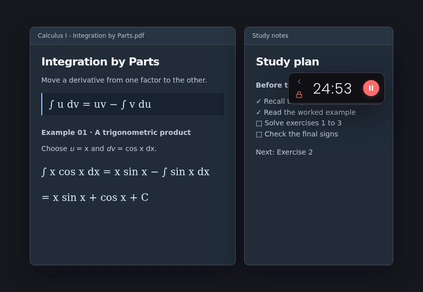
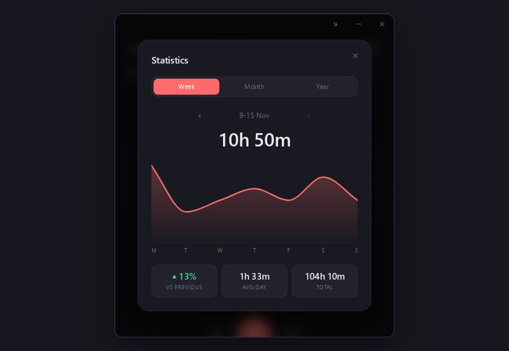
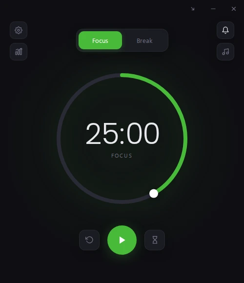

# Study Pomodoro

  <strong>A clean Pomodoro timer for Windows.</strong> 
  Set your rhythm, find your background sound, and give your work some space.

  <kbd>v2.1.1</kbd> &nbsp; <kbd>Windows 10 / 11</kbd> &nbsp; <kbd>Free &amp; ad-free</kbd> &nbsp; <kbd>Offline-first</kbd> &nbsp; <kbd>6 languages</kbd>

  <a href="https://apps.microsoft.com/detail/9PL141D6MJLR?cid=github-readme"><strong>Get Study Pomodoro from the Microsoft Store</strong></a>

  <a href="#highlights">Highlights</a> &nbsp; · &nbsp;
  <a href="#mini-mode">Mini mode</a> &nbsp; · &nbsp;
  <a href="#your-workspace">Your workspace</a> &nbsp; · &nbsp;
  <a href="https://ko-fi.com/ByCarrola">Support</a>

 

## Highlights

Study Pomodoro is built around a simple routine: focused work, a real break, then another session. Start with 25 minutes of focus and a 5-minute break, or choose the times that suit you.

<table>
  <tr>
    <td width="50%"><strong>Your own rhythm</strong> Adjust focus and break durations, with an optional automatic start for the next session.</td>
    <td width="50%"><strong>A little more screen space</strong> Keep the countdown in a small, always-on-top mini timer while you work.</td>
  </tr>
  <tr>
    <td><strong>A background that helps</strong> Choose from nine looping ambient sounds, from rain and café ambience to white and brown noise.</td>
    <td><strong>Progress you can see</strong> Explore your focus time by week, month and year, with trends and totals.</td>
  </tr>
  <tr>
    <td><strong>A look that feels right</strong> Switch between dark and light themes and choose a colour palette.</td>
    <td><strong>Offline, with optional sync</strong> Use the timer offline. Sign in with Google if you want your statistics and settings to follow you to another PC.</td>
  </tr>
</table>

## Mini mode

Less window. More workspace. Mini mode keeps the time, playback controls and progress in view, without covering the work you sat down to do. You can also lock its position.

## Sounds and statistics

Settle into a sound you like, then see your focused minutes add up over time.

Explore the nine ambient sounds

White Noise · Brown Noise · Pure 40Hz · Deep Focus · Binaural Beats · Rain · Birds · Beach · Coffee Shop

The sounds loop continuously, with adjustable volume. The end-of-session bell can be switched on or off independently.

## Your workspace

A calm dark theme, a light alternative, and colours that fit your setup. Use the custom theme editor to set separate focus, break and background colours, and save themes you can return to.

Images show sample statistics.

## Get started

1. [Install Study Pomodoro from the Microsoft Store](https://apps.microsoft.com/detail/9PL141D6MJLR?cid=github-readme).
2. Choose your focus and break lengths, then press play.
3. Add an ambient sound or switch to mini mode when you want more room.

Available in English, Portuguese, Spanish, French, German and Italian.

The app runs on **64-bit Windows 10 and Windows 11**. The core timer works offline; a Google account is optional and is only needed for cloud sync.

## Version 2.1.1

Version **2.1.1** fixes an issue with ambient audio when pausing the timer. The feedback button now opens the form on the official website, where you can also try the timer in your browser and watch the trailer.

Focus overtime is optional and only applies to focus sessions. It keeps counting after the bell, records the additional focus time, and moves to a break at `+59:59`, respecting the automatic-start setting.

## Support and feedback

Found something that could work better? Use the feedback option inside the app. If you enjoy Study Pomodoro, a [Microsoft Store review](https://apps.microsoft.com/detail/9PL141D6MJLR?cid=github-readme) or [a coffee on Ko-fi](https://ko-fi.com/ByCarrola) helps support its development.

[Website](https://carrolaxd.github.io/studypomodoro/) · [Privacy policy](https://carrolaxd.github.io/studypomodoro/privacy/) · [Ko-fi](https://ko-fi.com/ByCarrola) · [Microsoft Store](https://apps.microsoft.com/detail/9PL141D6MJLR?cid=github-readme)
